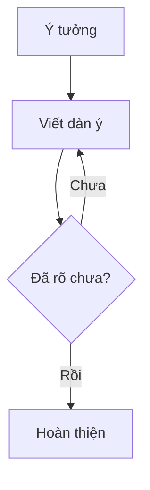
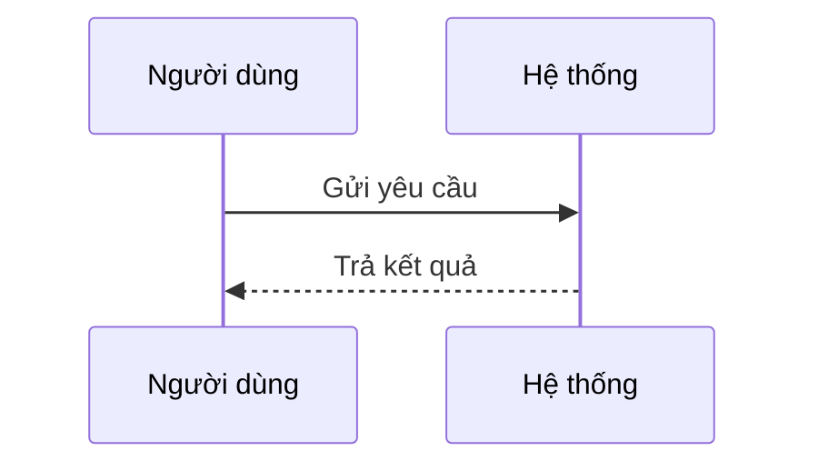

---
aliases:
  - Sổ tay cú pháp Obsidian
  - Obsidian cheat sheet
tags:
  - huong-dan/obsidian
created: 2026-10-15
---

# Obsidian — Sổ tay cú pháp Markdown

Tài liệu tra cứu bằng tiếng Việt, có ví dụ để sao chép khi học tập, ghi chú và quản lý công việc. Đối chiếu tài liệu chính thức ngày **15/10/2026**.

> [!tip] Cách dùng
> 1. Chép file `.md` này vào vault Obsidian của bạn.
> 2. Dùng mục lục để tìm cú pháp, rồi sao chép **nội dung bên trong** khung mã vào ghi chú.
> 3. Xem mã gốc bằng **Source mode**, vừa viết vừa xem bằng **Live Preview**, hoặc xem kết quả bằng **Reading view**.
>
> Các tên như `Ghi chú A`, `anh.png`, `tai-lieu.pdf` là ví dụ; hãy thay bằng tệp trong vault của bạn.

Phạm vi gồm Markdown thường dùng, cú pháp mở rộng của Obsidian, ví dụ Search, Templates và Bases. Cú pháp của plugin cộng đồng được ghi riêng ở phần tùy chọn.

## Mục lục

- [[#Tra cứu nhanh]]
- [[#Tiêu đề và đoạn văn]]
- [[#Định dạng chữ]]
- [[#Danh sách và công việc]]
- [[#Trích dẫn và đường phân cách]]
- [[#Liên kết ngoài]]
- [[#Liên kết ghi chú và heading]]
- [[#Liên kết đến block]]
- [[#Nhúng ghi chú và tệp]]
- [[#Callout]]
- [[#Bảng]]
- [[#Mã nguồn và ký tự đặc biệt]]
- [[#Tags và aliases]]
- [[#Properties — YAML đầu file]]
- [[#Chú thích và bình luận ẩn]]
- [[#Công thức toán]]
- [[#Sơ đồ Mermaid]]
- [[#HTML cơ bản]]
- [[#Tìm kiếm và khối query]]
- [[#Templates — mẫu chèn nhanh]]
- [[#Bases — bảng dữ liệu từ ghi chú]]
- [[#Plugin cộng đồng — tùy chọn]]
- [[#Mẫu ghi chú dùng ngay]]
- [[#Lỗi thường gặp]]

## Tra cứu nhanh

| Muốn làm | Gõ cú pháp |
| --- | --- |
| Tiêu đề | `## Tiêu đề` |
| In đậm | `**quan trọng**` |
| In nghiêng | `*nhấn mạnh*` |
| Tô sáng | `==cần nhớ==` |
| Gạch ngang chữ | `~~đã bỏ~~` |
| Việc chưa xong | `- [ ] Việc cần làm` |
| Việc đã xong | `- [x] Việc đã làm` |
| Liên kết ghi chú | `[[Ghi chú A]]` |
| Nhúng ghi chú | `![[Ghi chú A]]` |
| Tag | `#hoc-tap` |
| Mã trong dòng | `` `print("Xin chào")` `` |
| Công thức trong dòng | `$a^2+b^2=c^2$` |

## Tiêu đề và đoạn văn

Để một dấu cách sau `#`. Có sáu cấp tiêu đề:

````md
# Tiêu đề cấp 1
## Tiêu đề cấp 2
### Tiêu đề cấp 3
#### Tiêu đề cấp 4
##### Tiêu đề cấp 5
###### Tiêu đề cấp 6
````

Chừa một dòng trống để tách đoạn. Để xuống dòng trong cùng đoạn, dùng hai dấu cách ở cuối dòng hoặc `<br>`. Hiển thị xuống dòng còn phụ thuộc thiết lập **Strict line breaks**.

````md
Đây là đoạn thứ nhất.

Đây là đoạn thứ hai.

Dòng trên.<br>
Dòng dưới, vẫn cùng đoạn.
````

Các quy tắc nền tảng có trong [tài liệu Markdown](https://daringfireball.net/projects/markdown/syntax); cách Obsidian xử lý xuống dòng được mô tả trong [Basic formatting syntax](https://obsidian.md/help/syntax).

## Định dạng chữ

````md
**In đậm**
__Cũng in đậm__

*In nghiêng*
_Cũng in nghiêng_

***Vừa đậm vừa nghiêng***
**Đậm và _nghiêng lồng bên trong_**

~~Gạch ngang chữ~~
==Tô sáng==

Nội dung có `mã trong dòng`.
````

Theo [cú pháp Obsidian hiện hành](https://obsidian.md/help/syntax), có thể đặt emoji màu ngay sau dấu mở `==` để chọn màu tô sáng. Bản cũ có thể chưa hỗ trợ:

````md
==🔴Khẩn cấp==
==🟠Cần theo dõi==
==🟡Cần nhớ==
==🟢Đã hoàn thành==
==🔵Tham khảo==
==🟣Ý tưởng==
````

## Danh sách và công việc

````md
- Ý thứ nhất
- Ý thứ hai
    - Ý con
    - Ý con khác

1. Bước đầu tiên
2. Bước tiếp theo
    1. Bước nhỏ
    2. Bước nhỏ tiếp theo

- [ ] Đọc tài liệu
- [ ] Viết ghi chú
    - [x] Tạo dàn ý
    - [ ] Bổ sung ví dụ
- [x] Chuẩn bị tài liệu
````

Dùng `Tab` / `Shift+Tab` để tăng / giảm thụt lề. `*` và `+` cũng tạo được danh sách không đánh số. Checkbox cơ bản dùng `[ ]` và `[x]`; quản lý hạn chót hoặc lặp lại cần tính năng bổ sung.

## Trích dẫn và đường phân cách

````md
> Một ý đáng ghi lại.
>
> Đoạn thứ hai trong cùng trích dẫn.
>
>> Trích dẫn lồng bên trong.

Nội dung phía trên.

---

Nội dung phía dưới.
````

`***` hoặc `___` trên dòng riêng cũng tạo đường phân cách. Chừa dòng trống quanh đường phân cách để dễ đọc.

## Liên kết ngoài

````md
[Trang chủ Obsidian](https://obsidian.md)

[Trang chủ có mô tả](https://obsidian.md "Mở trang chủ")

<https://obsidian.md>

[Gửi email](mailto:ban@example.com)

[Tài liệu][nguon]

[nguon]: https://obsidian.md/help "Hướng dẫn Obsidian"
````

Đổi dấu cách trong đích liên kết thành `%20`, hoặc bọc đích có dấu cách bằng `<...>`:

````md
[Mở ghi chú](Ghi%20ch%C3%BA%20A.md)
[Mở ghi chú](<Ghi chú A.md>)
````

## Liên kết ghi chú và heading

[Wikilinks](https://obsidian.md/help/links) nối các ghi chú trong vault. `|` đổi chữ hiển thị của một liên kết.

````md
[[Ghi chú A]]
[[Ghi chú A|Chữ hiển thị]]
[[Du an/Ghi chú A]]

[[Ghi chú A#Kết luận]]
[[Ghi chú A#Kết luận|Xem kết luận]]

[[#Mục lục]]
[[#Mục lục|Về mục lục của ghi chú này]]

[[Ghi chú A#Chương 1#Khái niệm]]
````

Đường dẫn Wikilink có thư mục bắt đầu từ gốc vault và dùng `/`, kể cả trên Windows. Khi nhập `[[`, chọn đúng tệp từ gợi ý; nhập `[[#` để chọn heading trong ghi chú hiện tại.

Liên kết Markdown tương ứng:

````md
[Ghi chú A](Ghi%20ch%C3%BA%20A.md)
[Kết luận](Ghi%20ch%C3%BA%20A.md#K%E1%BA%BFt%20lu%E1%BA%ADn)
````

Muốn mở ghi chú từ ứng dụng khác, dùng [Obsidian URI](https://help.obsidian.md/Extending%2BObsidian/Obsidian%2BURI). Thay tên vault và tệp, rồi mã hóa giá trị URL:

````md
[Mở trong Obsidian](obsidian://open?vault=MyVault&file=Ghi%20ch%C3%BA%20A)
````

## Liên kết đến block

Một đoạn văn có thể gắn ID bằng `^ten-id`, rồi được liên kết bằng `#^ten-id`. ID dùng chữ Latin, số và dấu `-`, theo [hướng dẫn block reference](https://obsidian.md/help/links).

Trong ghi chú nguồn `Ghi chú A.md`:

````md
Đây là kết luận cần tái sử dụng. ^ket-luan
````

Trong ghi chú khác:

````md
[[Ghi chú A#^ket-luan]]
[[Ghi chú A#^ket-luan|Xem kết luận cụ thể]]
![[Ghi chú A#^ket-luan]]
````

Với cả danh sách, bảng, callout hoặc trích dẫn, đặt ID trên dòng riêng, có dòng trống trước và sau:

````md
- Chuẩn bị
- Thực hiện
- Kiểm tra

^quy-trinh

Đoạn tiếp theo.
````

Liên kết đến block cùng ghi chú dùng `[[#^quy-trinh]]`. Dấu `!` sẽ nhúng nội dung block thay vì chỉ tạo liên kết.

## Nhúng ghi chú và tệp

Thêm `!` trước Wikilink để [nhúng nội dung](https://obsidian.md/help/embeds):

````md
![[Ghi chú A]]
![[Ghi chú A#Kết luận]]
![[Ghi chú A#^ket-luan]]

![[anh.png]]
![[anh.png|400]]
![[anh.png|400x240]]


![[tai-lieu.pdf]]
![[tai-lieu.pdf#page=3]]
![[tai-lieu.pdf#page=3&height=500]]

![[ghi-am.mp3]]
![[bai-giang.mp4]]

![[So-do.canvas]]
````

Một số lưu ý:

- Chỉ ghi chiều rộng, như `|400`, để ảnh giữ tỷ lệ.
- Tệp không phải Markdown cần có phần mở rộng, như `.png` hoặc `.pdf`.
- Âm thanh và video phụ thuộc codec của thiết bị; xem [định dạng được hỗ trợ](https://obsidian.md/help/file-formats).
- Nhúng Canvas chỉ hiển thị hình dạng, không hiển thị chữ trong thẻ; mở Canvas để xem đầy đủ.

Với trang web, dùng [iframe](https://obsidian.md/help/embed-web-pages). Thay URL bên dưới bằng trang cho phép nhúng:

````html
<iframe src="https://example.com" width="100%" height="400"></iframe>
````

## Callout

[Callout](https://obsidian.md/help/callouts) tạo khung ghi chú. Duy trì dấu `>` trên các dòng thuộc khung.

````md
> [!note] Ghi nhớ
> Nội dung có thể chứa **chữ đậm** và [[Ghi chú A]].

> [!tip] Mẹo
> Mỗi ghi chú nên tập trung vào một chủ đề.

> [!warning] Chú ý
> Kiểm tra nguồn trước khi sử dụng thông tin.

> [!question]- Bấm để mở
> Dấu trừ làm khung thu gọn mặc định.

> [!example]+ Ví dụ mở sẵn
> Dấu cộng làm khung mở mặc định, vẫn có thể thu gọn.

> [!info] Khung ngoài
> Nội dung ngoài.
>
> > [!tip] Khung bên trong
> > Nội dung lồng nhau.
````

Các loại có sẵn và tên tương đương:

| Loại | Tên tương đương |
| --- | --- |
| `note` | — |
| `abstract` | `summary`, `tldr` |
| `info` | — |
| `todo` | — |
| `tip` | `hint`, `important` |
| `success` | `check`, `done` |
| `question` | `help`, `faq` |
| `warning` | `caution`, `attention` |
| `failure` | `fail`, `missing` |
| `danger` | `error` |
| `bug` | — |
| `example` | — |
| `quote` | `cite` |

## Bảng

Theo [cú pháp bảng của Obsidian](https://obsidian.md/help/advanced-syntax), dấu `:` ở hàng phân cách quy định căn trái, giữa hoặc phải:

````md
| Hạng mục | Trạng thái | Số lượng |
| :--- | :---: | ---: |
| Bài đọc | Đang làm | 3 |
| Ghi chú | Hoàn thành | 12 |
````

Trong bảng, escape dấu `|` nằm bên trong liên kết hoặc cú pháp kích thước ảnh:

````md
| Liên kết | Ảnh |
| --- | --- |
| [[Ghi chú A\|Tên ngắn]] | ![[anh.png\|120]] |
````

Dùng `<br>` để xuống dòng trong một ô. Muốn có đoạn văn, danh sách hoặc bố cục phức tạp, hãy đặt chúng ngoài bảng.

## Mã nguồn và ký tự đặc biệt

Mã trong dòng dùng một cặp dấu backtick. Nếu nội dung có backtick, dùng hai dấu bên ngoài:

````md
Chạy lệnh `git status`.
Dùng `` `backtick` `` như một phần nội dung mã.
````

Khối mã dùng ít nhất ba backtick, có thể thêm tên ngôn ngữ:

````md
```python
def chao(ten):
    return f"Xin chào, {ten}!"
```
````

`~~~` cũng làm hàng rào khối mã. Khi trình bày một ví dụ có ba backtick, dùng bốn backtick cho khối bên ngoài, như các khung ví dụ trong file này.

Thêm `\` trước ký tự để hiện nó nguyên dạng:

````md
\*Hiện dấu sao, không in nghiêng\*
\# Đây không phải heading
\[Đây là dấu ngoặc vuông\]
1\. Đây không phải danh sách đánh số
\| Hiện dấu gạch đứng
````

## Tags và aliases

[Tag](https://obsidian.md/help/tags) không có dấu cách; `/` tạo cấp con:

````md
#hoc-tap
#hoc-tap/toan
#du-an/website
#can-doc
````

Tag phải có ít nhất một ký tự không phải số: dùng `#nam2026` thay cho `#2026`.

[Alias](https://obsidian.md/help/aliases) là tên gọi khác của một ghi chú. Khai báo ở đầu file nguồn:

````yaml
---
aliases:
  - AI
  - Trí tuệ nhân tạo
tags:
  - hoc-tap
  - cong-nghe/ai
---
````

Khi gõ alias trong `[[...]]`, chọn từ gợi ý để Obsidian tạo liên kết đến đúng tệp, ví dụ `[[Artificial Intelligence|AI]]`. `|Tên hiển thị` chỉ đổi chữ tại một liên kết; `aliases` khai báo tên khác cho ghi chú.

## Properties — YAML đầu file

Đặt [Properties](https://obsidian.md/help/properties) ở **đầu tiên của file**, giữa hai dòng `---`. Ví dụ đủ các kiểu dữ liệu chính:

````yaml
---
title: "Kế hoạch học tập"
status: dang-lam
priority: 2
score: 8.5
completed: false
created: 2026-10-15
meeting: 2026-10-15T09:30:00
tags:
  - hoc-tap
  - ke-hoach/tuan
aliases:
  - Kế hoạch tuần
related:
  - "[[Mục tiêu tháng]]"
  - "[[Lịch học]]"
source: https://example.com
cssclasses:
  - my-note
---
````

- Text: `status`; Number: `priority`, `score`; Checkbox: `completed`.
- Date: `created`; Date & time: `meeting`; List: `related`; Tags: `tags`.
- Có thể chọn kiểu dữ liệu trong giao diện Properties. Cùng tên thuộc tính dùng cùng kiểu trong vault.
- Dùng dấu cách để thụt lề YAML; đặt Wikilink trong dấu nháy.
- `tags`, `aliases`, `cssclasses` dùng danh sách. Tag trong YAML không cần `#`.
- `cssclasses` chỉ có hiệu ứng khi theme hoặc CSS snippet định nghĩa lớp đó.
- Các khóa như `status` do bạn tự đặt; Markdown trong giá trị không được render.

## Chú thích và bình luận ẩn

Chú thích cuối trang và chú thích nội dòng thuộc [cú pháp Obsidian](https://obsidian.md/help/syntax):

````md
Ý này có nguồn tham khảo.[^nguon]

[^nguon]: Ghi tên tài liệu hoặc URL tại đây.
    Dòng tiếp theo thụt vào để tiếp tục chú thích.

Một câu có chú thích nội dòng.^[Nội dung chú thích ngắn.]
````

Chú thích nội dòng `^[...]` hiển thị trong Reading view, chưa được hỗ trợ trong Live Preview.

````md
Nội dung hiển thị. %% Ghi chú ẩn trong dòng. %%

%%
Ghi chú ẩn nhiều dòng.
Chỉ dùng để nhắc việc biên tập.
%%

<!-- Bình luận HTML cũng có thể dùng. -->
````

Bình luận `%%...%%` bị ẩn trong Reading view nhưng vẫn nằm trong file. Luôn đóng cặp `%%` để tránh ẩn phần còn lại.

## Công thức toán

Obsidian dùng [MathJax với ký hiệu LaTeX](https://obsidian.md/help/advanced-syntax). `$...$` đặt trong dòng, `$$...$$` tạo khối riêng:

````md
Định lý: $a^2+b^2=c^2$.

$$
x = \frac{-b \pm \sqrt{b^2-4ac}}{2a}
$$

$$
\begin{aligned}
f(x) &= x^2 + 2x + 1 \\
     &= (x+1)^2
\end{aligned}
$$
````

Các thành phần thường dùng:

````tex
x_i                % chỉ số dưới
x^2                % số mũ
\frac{a}{b}        % phân số
\sqrt{x}           % căn bậc hai
\sum_{i=1}^{n} i   % tổng
\int_0^1 x\,dx     % tích phân
\alpha + \beta     % chữ Hy Lạp
\vec{v}            % vector
\text{nội dung}    % chữ trong công thức
````

## Sơ đồ Mermaid

Tạo khối mã có nhãn `mermaid`; Obsidian có thể [render sơ đồ Mermaid](https://obsidian.md/help/advanced-syntax) mà không cần plugin cộng đồng.

````md

````

Sơ đồ trình tự:

````md

````

Mermaid có hệ cú pháp riêng; xem [hướng dẫn chính thức](https://mermaid.js.org/intro/) để mở rộng. Nếu sơ đồ dùng cú pháp mới chưa render, kiểm tra phiên bản Mermaid đi kèm Obsidian.

## HTML cơ bản

Theo [hướng dẫn HTML](https://obsidian.md/help/html), có thể dùng HTML cho một số định dạng bổ sung:

````html
<u>Gạch chân</u>
<mark>Đánh dấu</mark>
H<sub>2</sub>O
x<sup>2</sup>
Dòng một<br>Dòng hai
<span style="color: #d97706;">Chữ màu cam</span>
````

Trong khối HTML, viết nội dung bằng HTML; không dựa vào `**Markdown**` bên trong để tạo định dạng. Khối HTML cần hoàn chỉnh, tránh dòng trống giữa khối.

## Tìm kiếm và khối query

Cần bật core plugin **Search**. Các mẫu dưới đây dùng trong ô tìm kiếm; chi tiết ở [Search](https://obsidian.md/help/plugins/search).

| Truy vấn | Tác dụng |
| --- | --- |
| `hoc tap` | Có cả hai từ |
| `"kế hoạch tuần"` | Tìm cụm từ |
| `hoc OR lam` | Có một trong hai từ |
| `hoc -thi` | Có `hoc`, loại `thi` |
| `file:2026` | Tên tệp chứa `2026` |
| `path:"Du an"` | Đường dẫn chứa `Du an` |
| `tag:#hoc-tap` | Tìm theo tag |
| `line:(doc sach)` | Cả hai từ trên cùng dòng |
| `task-todo:doc` | Công việc chưa xong có `doc` |
| `task-done:doc` | Công việc đã xong có `doc` |
| `[status:dang-lam]` | Tìm giá trị Property |
| `[deadline]` | Có Property `deadline` |
| `/\d{4}-\d{2}-\d{2}/` | Tìm chuỗi ngày bằng regex |

Nhúng kết quả tìm kiếm vào ghi chú:

````md
```query
tag:#hoc-tap task-todo:
```
````

Khối `query` hiển thị kết quả tìm kiếm; không phải bảng cơ sở dữ liệu hay công thức tính toán.

## Templates — mẫu chèn nhanh

Cần bật core plugin **Templates**. Tạo thư mục `Templates`, chọn thư mục đó trong thiết lập plugin, rồi dùng lệnh **Templates: Insert template**. Các biến theo [tài liệu Templates](https://obsidian.md/help/plugins/templates):

| Biến | Giá trị khi chèn mẫu |
| --- | --- |
| `{{title}}` | Tên ghi chú hiện tại |
| `{{date}}` | Ngày hiện tại |
| `{{time}}` | Giờ hiện tại |
| `{{date:YYYY-MM-DD}}` | Ngày theo định dạng chỉ định |
| `{{time:HH:mm}}` | Giờ và phút |

Lưu nội dung sau thành một ghi chú trong thư mục Templates:

````md
---
created: "{{date:YYYY-MM-DD}}"
tags:
  - nhat-ky
---

# {{title}}

Ngày: {{date:DD/MM/YYYY}} — {{time:HH:mm}}

## Ba việc ưu tiên

- [ ] Việc 1
- [ ] Việc 2
- [ ] Việc 3

## Ghi nhanh

-

## Nhìn lại

- Điều đã làm tốt:
- Điều cần cải thiện:
````

Biến được thay khi chèn template, không tự đổi ngày mỗi lần mở ghi chú. Chỉnh template trong Source mode và giữ dấu nháy quanh biến trong YAML.

## Bases — bảng dữ liệu từ ghi chú

Cần bật core plugin **Bases**. Có thể nhúng một tệp `.base` hoặc viết khối `base` trong ghi chú, theo [Create a base](https://obsidian.md/help/bases/create-base) và [Bases syntax](https://obsidian.md/help/bases/syntax).

````md
![[Danh-sach-ghi-chu.base]]
````

Ví dụ bảng các ghi chú mang tag `hoc-tap`:

````md
```base
filters:
  and:
    - 'file.ext == "md"'
    - 'file.hasTag("hoc-tap")'
views:
  - type: table
    name: "Ghi chú học tập"
    order:
      - file.name
      - note.status
      - note.created
```
````

`file.name` là thuộc tính tệp; `note.status` và `note.created` lấy từ YAML của ghi chú. `order` trong ví dụ chọn thứ tự cột. Bases có hệ lọc và công thức riêng; ví dụ này là điểm bắt đầu để chỉnh tiếp trong giao diện.

## Plugin cộng đồng — tùy chọn

Chỉ dùng các ví dụ trong phần này khi đã cài và bật plugin tương ứng.

### Dataview

Ví dụ [truy vấn bảng Dataview](https://blacksmithgu.github.io/obsidian-dataview/queries/query-types/) cho các ghi chú có tag `hoc-tap`:

````md
```dataview
TABLE status AS "Trạng thái", created AS "Ngày tạo"
FROM #hoc-tap
SORT created DESC
```
````

### Templater

[Templater](https://silentvoid13.github.io/Templater/internal-functions/internal-modules/date-module.html) có cú pháp riêng, chẳng hạn:

````md
Ngày tạo: <% tp.date.now("YYYY-MM-DD") %>
````

`<% ... %>` thuộc Templater; `{{date}}` thuộc core plugin Templates. Mỗi loại cần được xử lý bằng plugin tương ứng.

## Mẫu ghi chú dùng ngay

Sao chép **nội dung trong khung bên dưới** vào một ghi chú mới, sửa tiêu đề, ngày và nội dung. Mẫu này dùng được với các tính năng có sẵn của Obsidian.

````md
---
created: 2026-10-15
status: dang-lam
tags:
  - ghi-chu
aliases: []
---

# Tên chủ đề

> [!abstract] Tóm tắt
> Viết 1–3 câu nêu ý chính của chủ đề.

## Điều hướng

- [[#Mục tiêu]]
- [[#Nội dung chính]]
- [[#Việc cần làm]]
- [[#Kết luận]]
- [[#Nguồn tham khảo]]

## Mục tiêu

- Tôi muốn hiểu hoặc hoàn thành điều gì?

## Nội dung chính

### Ý thứ nhất

- Giải thích:
- Ví dụ:

### Ý thứ hai

- Giải thích:
- Ví dụ:

> [!question]- Câu hỏi cần giải đáp
> Viết câu hỏi hoặc điểm chưa rõ tại đây.

## Việc cần làm

- [ ] Đọc thêm tài liệu
- [ ] Bổ sung ví dụ
- [ ] Kiểm tra lại ghi chú

## Kết luận

Điều quan trọng nhất tôi rút ra là…

## Nguồn tham khảo

- [Tên tài liệu](https://example.com)

%% Thay đường dẫn ví dụ bằng nguồn thật trước khi sử dụng. %%
````

## Lỗi thường gặp

| Hiện tượng | Cách xử lý |
| --- | --- |
| Cú pháp hiện nguyên dạng | Kiểm tra có đang viết bên trong khối mã không; chuyển sang Reading view để xem kết quả. |
| Heading không nhận | Thêm dấu cách sau `#`. |
| Checkbox không nhận | Dùng đúng `- [ ] Nội dung`, gồm các dấu cách. |
| Callout bị đứt đoạn | Thêm `>` ở mọi dòng trong khung, kể cả dòng trống. |
| Bảng bị vỡ cột | Escape dấu `\|` bên trong liên kết hoặc kích thước ảnh. |
| Property không nhận | Đặt YAML ở đầu file, có hai dòng `---`, dùng dấu cách khi thụt lề. |
| Nhúng không tìm thấy tệp | Chọn lại tệp qua gợi ý `[[`; kiểm tra đường dẫn và phần mở rộng. |
| Template giữ nguyên biến | Chèn bằng đúng lệnh của Templates hoặc Templater. |
| `dataview`, `base`, `query` chưa render | Bật plugin tương ứng, kiểm tra nhãn khối và xem trong Reading view. |
| Không thấy phần cuối ghi chú | Kiểm tra khối mã hoặc bình luận `%%` chưa được đóng. |

[[#Mục lục|↑ Về mục lục]]
